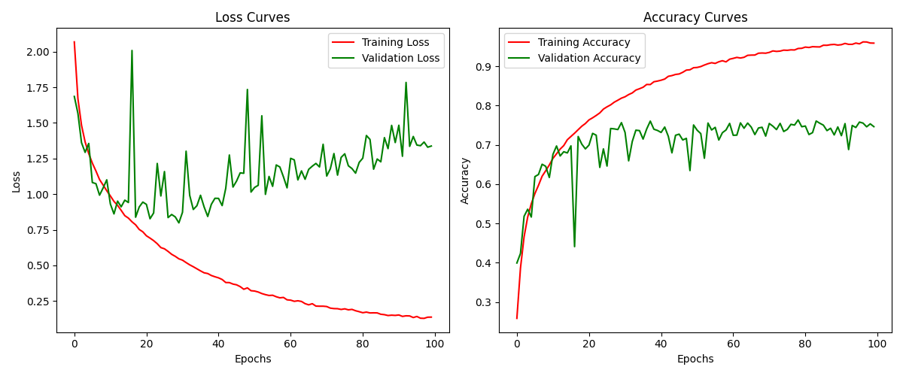
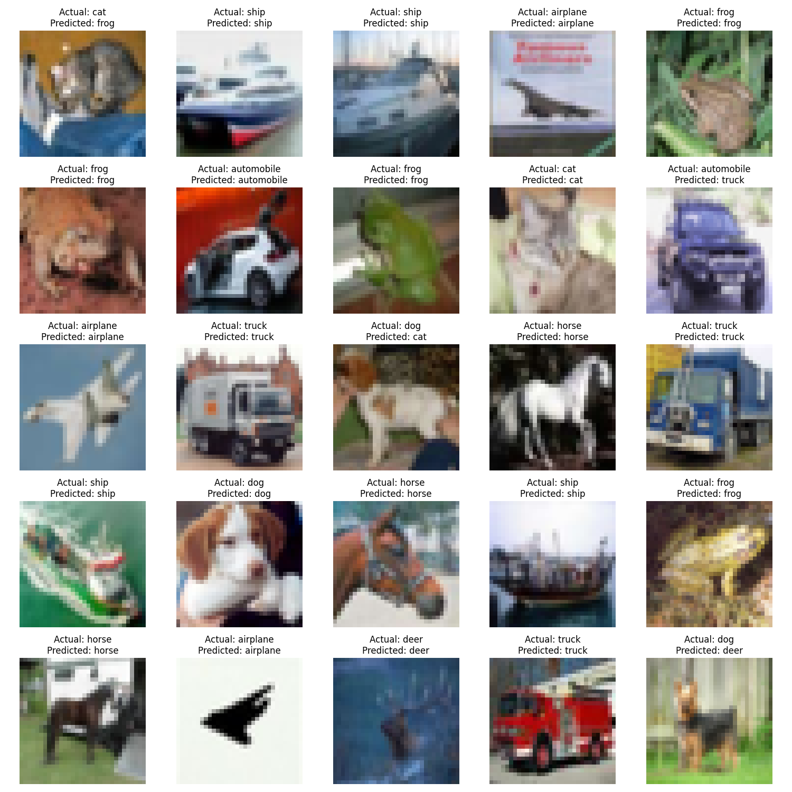

# Image Classification & Object Detection

Two deep learning computer vision projects in one repository: a **CNN that classifies CIFAR-10 images** and a **YOLOv3 object detector** that finds and labels objects in photos. Both are tracked with MLflow, and a small web interface lets you upload an image and see the results.

<!-- TODO: add a demo GIF or screenshot here, e.g.  -->

## Results

| Project | Model | Result |
|---|---|---|
| CIFAR-10 classification | Custom CNN (BatchNorm + Dropout) | **XX.X% test accuracy** *75.8400022983551* |
| Object detection | YOLOv3 (Darknet-53, pretrained COCO weights) | Detects the 80 COCO classes with bounding boxes |

Training curves and sample predictions:




## 1. CIFAR-10 Image Classification

- Convolutional neural network built with TensorFlow/Keras
- Batch normalization and dropout to reduce overfitting
- Data augmentation (examples in `augmented_images/`)
- Best model saved with checkpointing (`best_model.h5`)
- Evaluation with a classification report and per-class metrics (`classification_report.json`, `classification_results.csv`)
- Every training run logged with MLflow (parameters, metrics, models)

## 2. YOLOv3 Object Detection

- YOLOv3 with a Darknet-53 backbone
- Multi-class detection using the COCO class list (`coco.names`)
- Bounding boxes and labels drawn on the output image
- Script: `object_detection.py`

## Web Interface

`app.py` serves a simple web page where you upload an image and get back the classification or detection result (`templates/`).

## Tech Stack

Python, TensorFlow / Keras, OpenCV, MLflow, NumPy, pandas, scikit-learn, Matplotlib, Seaborn, Pillow

## Project Structure

```
├── app.py                  # Web app for uploading images and viewing results
├── object_detection.py     # YOLOv3 detection script
├── image_classification/   # CIFAR-10 CNN code
├── model/                  # Saved models
├── templates/              # HTML pages (upload and results)
├── sample_images/          # Images for testing
├── augmented_images/       # Data augmentation examples
├── best_model.h5           # Best trained CIFAR-10 model
├── classification_report.json
├── classification_results.csv
├── training_history.png
├── predictions.png
└── coco.names              # COCO class names
```

## Getting Started

```bash
# 1. Create and activate a virtual environment
python -m venv venv
source venv/bin/activate        # Linux/Mac
venv\Scripts\activate           # Windows

# 2. Install dependencies
pip install -r requirements.txt

# 3. Download the YOLOv3 weights (needed for detection only)
wget https://pjreddie.com/media/files/yolov3.weights

# 4. Run the web app
python app.py
```

Then open the local address printed in the terminal.

To run detection on a single image from the command line:

```bash
python object_detection.py
```

To view the MLflow experiment dashboard:

```bash
mlflow ui
```

